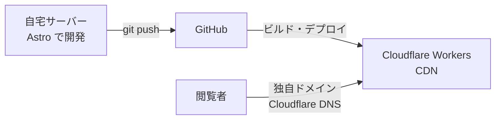

# Portfolio v1 設計書

## 1. 目的

面接官や採用担当者に、次の2つを伝える。

- 技術を選んだ理由を説明でき、作ったものを運用している
- プロダクトを最初から考えて作り、運用できる

あわせて、仕事を依頼したい人や自分を知りたい人が見ても問題ない内容にする。

## 2. スコープ

### MVP（v0.1）でやること

| 項目 | 内容 |
|---|---|
| 自己紹介 | キャリア、経歴 |
| 技術力 | 使える技術の一覧 |
| Works | homestat（開発中）、oshiato |
| Blog | 1 記事以上（自宅サーバーの構築記録） |
| 連絡先 | メール、GitHub・X へのリンク（フォームは作らない） |

### MVP ではやらないこと

- Blog・Works の管理画面
- 多言語対応
- homestat のデータの埋め込み（Works への作品紹介の掲載は MVP でやる）

## 3. 非機能要件

| 項目 | 値 |
|---|---|
| 月額コスト | 0 円（ドメイン代は除く） |
| SLO | 1ヶ月の稼働率 99%（約 7 時間まで停止を許容）。外部監視サービスで計測する |
| 想定アクセス数 | 1日 100 PV 以下 |
| 更新頻度 | 数週間に 1 回 |

## 4. 構成



| 項目 | 選択 | 理由 |
|---|---|---|
| 方式 | SSG + CDN | 閲覧者によって内容が変わらず、更新頻度も低いため。ページの表示も速くなる |
| フレームワーク | Astro | コンテンツサイト向けのため |
| ホスティング | Cloudflare Workers | CDN があり、無料で使えるため |
| DNS | Cloudflare | ドメインを Cloudflare で管理しているため |

<!-- TODO: 各理由を ADR（docs/adr/）で他の候補と比較して補強する -->

## 5. データモデル

### Work

| 項目 | 型 | 必須 | 説明 |
|---|---|---|---|
| `title` | string | ✅ | 作品名 |
| `summary` | string | ✅ | 一覧に表示する一行の説明 |
| `problem` | string | ✅ | 誰のどんな困りごとを解決するか |
| `status` | `開発中` \| `運用中` \| `終了` | ✅ | 開発の状態 |
| `startedAt` | date | ✅ | 開発を始めた日 |
| `stack` | string[] | ✅ | 使った技術 |
| `githubUrl` | URL | | リポジトリ |
| `demoUrl` | URL | | 動いているものの URL |
| `order` | number | | 並び順（小さいほど上） |

本文は次の見出しで書く。

```markdown
## なぜ作ったか
## 構成と技術の選定
## 工夫したこと・苦労したこと
## 学んだこと
## 今後やりたいこと
```

### Article

| 項目 | 型 | 必須 | 説明 |
|---|---|---|---|
| `title` | string | ✅ | 記事のタイトル |
| `description` | string | ✅ | 一覧と OGP に使う説明文 |
| `publishedAt` | date | ✅ | 公開日 |
| `updatedAt` | date | | 更新日 |
| `tags` | string[] | ✅ | タグ |
| `draft` | boolean | | `true` なら本番では非公開（デフォルト `false`） |
| `relatedWork` | Work の参照 | | 関係する作品 |

## 6. 未決事項

| 事項 | いつ決めるか | 判断基準 |
|---|---|---|
| 見た目のデザイン（色、フォント、レイアウト） | 実装しながら | まず読みやすさ。凝ったデザインは v0.1 ではやらない |
| デプロイ方法（Cloudflare の Git 連携か GitHub Actions か） | v0.1 は Git 連携。移行は v0.2 以降 | テストや lint を CI で回したくなったら GitHub Actions を検討する |
| アクセス解析 | v0.2 | 候補は Cloudflare Web Analytics（無料、Cookie なし） |
| OGP 画像 | v0.2 | 記事ごとに自動生成するかどうか |
| Terraform での管理 | v1.0 まで | 手作業での設定が一通り終わってから、コードに置き換える |
| homestat の埋め込み方法（キャッシュを含む） | v1.0 | 数分ごとに変わるデータを CDN でキャッシュしてよいか |
